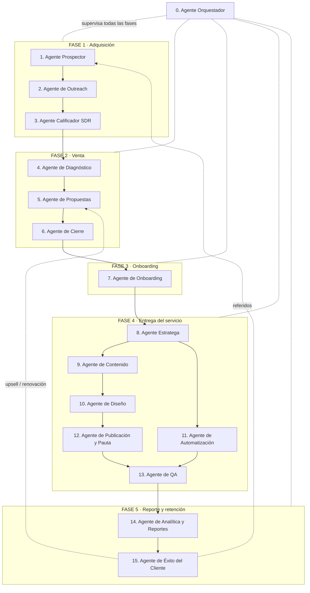

# AMDA — Workflow de Agentes de IA

**Agencia de Marketing Digital y Automatización**

Este documento define el flujo de trabajo automatizado de la agencia: qué agentes se necesitan, qué tareas realiza cada uno, qué recibe como entrada y qué entrega al siguiente agente. El objetivo es que la propia agencia funcione con el mismo tipo de automatización que vende: **conseguir clientes → vender → entregar el servicio → retener y crecer la cuenta**.

---

## Vista general del flujo

---

## Agente 0 — Orquestador (Director de Operaciones)

El único agente que no pertenece a una fase: coordina a todos los demás.

| | |
|---|---|
| **Tareas** | Asignar trabajo a cada agente según la etapa del cliente; monitorear que ningún lead o proyecto se quede estancado; escalar a un humano cuando un agente falla o cuando hay una decisión sensible (descuentos, quejas, cancelaciones); mantener el CRM/tablero como fuente única de verdad. |
| **Entrada** | Eventos de todos los agentes (lead nuevo, propuesta enviada, contrato firmado, entrega lista, reporte generado). |
| **Salida** | Instrucciones de trabajo al agente correspondiente + alertas al humano responsable. |
| **Disparador** | Continuo (por eventos y revisión programada diaria). |
| **Escala a humano** | Cualquier bloqueo mayor a 24 h, quejas de cliente, decisiones de precio fuera de tarifario. |

---

## FASE 1 · Adquisición — conseguir clientes

### Agente 1 — Prospector (Investigación de mercado)

| | |
|---|---|
| **Tareas** | Buscar negocios que encajen con el cliente ideal de AMDA (pymes locales, e-commerce, profesionistas con procesos manuales); investigar cada prospecto: sitio web, redes sociales, reseñas, señales de dolor (no responden mensajes, sin agenda en línea, publicaciones inconsistentes); puntuar cada lead (fit + señal de necesidad). |
| **Entrada** | Perfil de cliente ideal (ICP) definido por AMDA + fuentes (Google Maps, directorios, Instagram, LinkedIn). |
| **Salida → Agente 2** | Lista de leads calificados en el CRM con: nombre del negocio, contacto, canal preferido, dolor detectado y puntuación. |
| **Disparador** | Programado (diario o semanal, por lote). |
| **Escala a humano** | Nunca necesita; solo reporta volumen y calidad de leads. |

### Agente 2 — Outreach (Primer contacto)

| | |
|---|---|
| **Tareas** | Redactar mensajes de primer contacto **personalizados** por lead (email, WhatsApp o DM) mencionando el dolor detectado por el Prospector; enviar en secuencia (contacto inicial + 2–3 seguimientos espaciados); clasificar respuestas: interesado / no interesado / sin respuesta. |
| **Entrada** | Lista de leads calificados del Agente 1 + plantillas y tono de marca de AMDA. |
| **Salida → Agente 3** | Leads que respondieron con interés, con el historial completo de la conversación. |
| **Disparador** | Al recibir leads nuevos del Prospector. |
| **Escala a humano** | Respuestas agresivas o solicitudes de baja (se respetan de inmediato). |

### Agente 3 — Calificador (SDR conversacional)

| | |
|---|---|
| **Tareas** | Conversar con el lead interesado para calificarlo: presupuesto aproximado, autoridad de decisión, necesidad concreta y urgencia (BANT); responder preguntas frecuentes sobre servicios y precios base; **agendar la llamada de diagnóstico** en el calendario (Calendly). |
| **Entrada** | Conversaciones de leads interesados del Agente 2 + tarifario y FAQ de AMDA. |
| **Salida → Agente 4** | Cita agendada + **brief del prospecto**: quién es, qué necesita, presupuesto estimado, urgencia y notas de la conversación. |
| **Disparador** | Al detectar respuesta de interés. |
| **Escala a humano** | Leads de ticket alto o que piden hablar directamente con una persona. |

---

## FASE 2 · Venta

### Agente 4 — Diagnóstico (Auditoría del negocio)

| | |
|---|---|
| **Tareas** | Antes de la llamada, auditar el negocio del prospecto: presencia digital, embudo actual, procesos manuales automatizables, competencia local; preparar un documento de diagnóstico con 3–5 oportunidades concretas y el impacto estimado de cada una; generar el guion de la llamada de ventas. |
| **Entrada** | Brief del prospecto del Agente 3. |
| **Salida → Agente 5** | Documento de auditoría + oportunidades priorizadas + guion de llamada. (La llamada la hace el humano o un agente de voz, apoyado en este material.) |
| **Disparador** | Al agendarse una cita (debe estar listo antes de la llamada). |
| **Escala a humano** | Siempre entrega al humano el material antes de la llamada. |

### Agente 5 — Propuestas (Cotización)

| | |
|---|---|
| **Tareas** | Convertir el diagnóstico + las notas de la llamada en una propuesta formal: alcance, entregables, tiempos, precio y condiciones de pago; generar el documento con la plantilla de marca de AMDA; preparar el enlace de pago/anticipo (Stripe) y el contrato. |
| **Entrada** | Auditoría del Agente 4 + notas de la llamada de ventas + tarifario. |
| **Salida → Agente 6** | Propuesta lista para enviar + contrato + enlace de pago. |
| **Disparador** | Al terminar la llamada de diagnóstico (meta: propuesta enviada en menos de 24 h). |
| **Escala a humano** | Aprobación del precio final antes de enviar si sale del tarifario estándar. |

### Agente 6 — Cierre (Seguimiento y firma)

| | |
|---|---|
| **Tareas** | Enviar la propuesta y dar seguimiento (recordatorios a 2, 5 y 8 días); responder objeciones frecuentes (precio, tiempos, garantías) con argumentos aprobados; gestionar la firma del contrato y confirmar el pago del anticipo; si el lead no cierra, registrar el motivo y moverlo a una campaña de "nutrición" para reintentarlo en 60–90 días. |
| **Entrada** | Propuesta + contrato + enlace de pago del Agente 5. |
| **Salida → Agente 7** | **Contrato firmado + anticipo pagado + expediente de venta** (todo lo prometido al cliente, condiciones y fechas). |
| **Disparador** | Al estar lista la propuesta. |
| **Escala a humano** | Negociaciones de descuento, cambios de alcance o cualquier modificación al contrato. |

---

## FASE 3 · Onboarding

### Agente 7 — Onboarding (Alta del cliente)

| | |
|---|---|
| **Tareas** | Enviar bienvenida y formulario de onboarding (accesos a redes, sitio web, logos, materiales de marca, cuentas publicitarias); verificar que todos los accesos funcionen; crear el expediente del cliente (carpeta en Drive, tablero de proyecto, canal de comunicación); agendar la llamada de kickoff. |
| **Entrada** | Expediente de venta del Agente 6. |
| **Salida → Agente 8** | **Expediente completo del cliente**: accesos verificados, materiales de marca, objetivos acordados, alcance contratado y fecha de inicio. |
| **Disparador** | Al confirmarse el pago del anticipo. |
| **Escala a humano** | Cliente que no entrega accesos en 5 días (el humano llama). |

---

## FASE 4 · Entrega del servicio

### Agente 8 — Estratega (Plan de trabajo)

| | |
|---|---|
| **Tareas** | Traducir el alcance contratado en un plan de ejecución mensual: objetivos medibles (KPIs), calendario de contenido, campañas de pauta y automatizaciones a construir; dividir el plan en tareas asignables a los agentes ejecutores. |
| **Entrada** | Expediente del cliente del Agente 7. |
| **Salida → Agentes 9 y 11** | Plan de trabajo aprobado: brief de contenido para el Agente 9 y especificación técnica de automatizaciones para el Agente 11. |
| **Disparador** | Al completarse el onboarding, y luego cada inicio de mes. |
| **Escala a humano** | El plan del primer mes lo aprueba un humano antes de ejecutar. |

### Agente 9 — Contenido (Copywriting)

| | |
|---|---|
| **Tareas** | Redactar los copies del calendario: publicaciones, anuncios, emails, guiones de reels; adaptar el tono a la marca de cada cliente; entregar el calendario con fechas, canales y llamadas a la acción. |
| **Entrada** | Brief de contenido del Agente 8 + materiales de marca del expediente. |
| **Salida → Agente 10** | Calendario de contenido con todos los textos listos, indicando qué pieza gráfica necesita cada publicación. |
| **Disparador** | Al recibir el brief mensual. |
| **Escala a humano** | Temas sensibles (salud, legal, finanzas) pasan por revisión humana. |

### Agente 10 — Diseño (Creativos)

| | |
|---|---|
| **Tareas** | Producir las piezas gráficas del calendario (posts, historias, anuncios, miniaturas) usando las plantillas de marca (Canva); mantener consistencia visual por cliente; exportar en los formatos de cada canal. |
| **Entrada** | Calendario con copies del Agente 9 + brand kit del cliente. |
| **Salida → Agente 12** | Paquete de creativos terminados, nombrados y vinculados a cada publicación del calendario. |
| **Disparador** | Al recibir el calendario con copies. |
| **Escala a humano** | Primera tanda de cada cliente nuevo se aprueba con el cliente antes de publicar. |

### Agente 11 — Automatización (Construcción técnica)

| | |
|---|---|
| **Tareas** | Construir las automatizaciones vendidas al cliente: chatbots de WhatsApp/Instagram, respuestas automáticas, flujos en Make, integraciones con CRM, agenda en línea, recordatorios de cita, seguimiento de leads del cliente; documentar cada flujo construido. |
| **Entrada** | Especificación técnica del Agente 8 + accesos del expediente. |
| **Salida → Agente 13** | Automatizaciones construidas en ambiente de prueba + documentación de cada flujo. |
| **Disparador** | Al recibir la especificación técnica. |
| **Escala a humano** | Integraciones que requieren permisos que el cliente no ha dado. |

### Agente 12 — Publicación y Pauta (Campañas)

| | |
|---|---|
| **Tareas** | Programar y publicar el contenido aprobado en cada canal; montar y lanzar las campañas de pauta (Meta/Google) según el plan; monitorear el gasto diario y pausar anuncios con mal desempeño; hacer optimizaciones básicas (presupuesto, audiencias, creativos ganadores). |
| **Entrada** | Creativos del Agente 10 + plan de pauta del Agente 8. |
| **Salida → Agente 13** | Campañas activas + registro de publicaciones + bitácora de optimizaciones. |
| **Disparador** | Fechas del calendario de contenido. |
| **Escala a humano** | Cambios de presupuesto mayores al 20 % o campañas rechazadas por la plataforma. |

### Agente 13 — QA (Control de calidad)

| | |
|---|---|
| **Tareas** | Revisar todo antes de que llegue al cliente: ortografía y tono de los copies, consistencia visual, enlaces y botones funcionando, automatizaciones probadas de punta a punta (mensaje de prueba, cita de prueba, pago de prueba); aprobar el paso a producción o regresar con correcciones al agente responsable. |
| **Entrada** | Entregables de los Agentes 11 y 12. |
| **Salida → Agente 14** | Entregables aprobados en producción + checklist de QA firmado. |
| **Disparador** | Cada entregable terminado. |
| **Escala a humano** | Dos rechazos consecutivos del mismo entregable. |

---

## FASE 5 · Reporte y retención

### Agente 14 — Analítica y Reportes

| | |
|---|---|
| **Tareas** | Recolectar métricas de todos los canales (alcance, leads generados, conversaciones del chatbot, citas agendadas, ventas atribuidas, gasto publicitario); comparar contra los KPIs del plan; generar el **reporte mensual** en lenguaje claro para el cliente: qué se hizo, qué resultados dio y qué sigue. |
| **Entrada** | Datos de campañas y automatizaciones en producción (Agente 13) + KPIs del plan (Agente 8). |
| **Salida → Agente 15** | Reporte mensual + semáforo de salud de la cuenta (verde/amarillo/rojo) + recomendaciones. |
| **Disparador** | Programado (semanal interno, mensual para cliente). |
| **Escala a humano** | Cuenta en rojo dos semanas seguidas. |

### Agente 15 — Éxito del Cliente (Account Manager)

| | |
|---|---|
| **Tareas** | Enviar el reporte al cliente y agendar la revisión mensual; atender dudas y solicitudes del día a día; medir satisfacción (NPS trimestral); **detectar oportunidades de upsell** (nuevos servicios que el cliente necesita) y gestionar renovaciones antes del vencimiento; pedir testimonios y referidos a clientes satisfechos. |
| **Entrada** | Reporte y semáforo del Agente 14 + historial de la cuenta. |
| **Salida → cierra el ciclo** | Upsells y renovaciones → **regresan al Agente 5** (nueva propuesta). Referidos → **regresan al Agente 1** (nuevos leads). Feedback → al Agente 8 para ajustar el plan del siguiente mes. |
| **Disparador** | Al recibir el reporte mensual + eventos de la cuenta (queja, solicitud, vencimiento próximo). |
| **Escala a humano** | Riesgo de cancelación, quejas formales y toda negociación de renovación. |

---

## Reglas del flujo (handoffs)

1. **Nada avanza sin su entregable.** Cada agente solo arranca cuando recibe la salida completa del anterior; si falta algo, lo devuelve con la lista de faltantes.
2. **El CRM es la fuente de verdad.** Todo lead, cliente y proyecto vive en el tablero central con su etapa actual; los agentes leen y escriben ahí, nunca en canales sueltos.
3. **Todo handoff deja registro:** qué se entregó, cuándo y a quién. El Orquestador audita esto para detectar cuellos de botella.
4. **El humano aprueba lo irreversible:** precios fuera de tarifario, contratos, primer contenido de cada cliente nuevo, presupuestos de pauta y cualquier comunicación de crisis.
5. **Ciclo cerrado:** la Fase 5 alimenta a las Fases 1 y 2 (referidos y upsells), de modo que la agencia crece con su propia operación.

## Orden de implementación sugerido

No construyas los 16 agentes a la vez. Orden recomendado por retorno inmediato:

| Prioridad | Agentes | Por qué primero |
|---|---|---|
| 1 | 3 (Calificador) + 7 (Onboarding) | Son los que más tiempo manual consumen hoy y los más fáciles de automatizar con chatbot + formularios. |
| 2 | 1 (Prospector) + 2 (Outreach) | Llenan el embudo; sin leads no hay agencia. |
| 3 | 5 (Propuestas) + 6 (Cierre) | Acortan el ciclo de venta a menos de una semana. |
| 4 | 9, 10, 12 (Contenido, Diseño, Publicación) | Automatizan la entrega recurrente del servicio. |
| 5 | 14 + 15 (Reportes y Éxito del Cliente) | Retención y crecimiento de cuentas. |
| 6 | 0, 4, 8, 11, 13 (Orquestador, Diagnóstico, Estratega, Automatización, QA) | Se van sofisticando conforme crece el volumen; al inicio estos roles los cubre el humano. |

